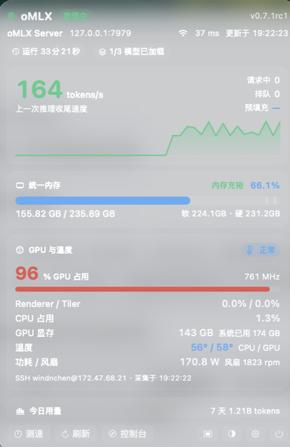
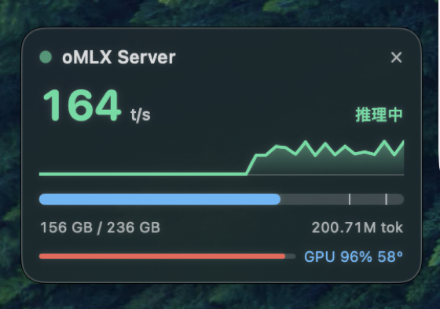

# oMLX 桌面小工具

> 原生 macOS 菜单栏工具，用来盯住跑 oMLX 推理服务的那台机器。

实时看到**生成速度、token 用量、统一内存压力、GPU 占用与温度、模型加载状态**——
不用切窗口，不用开浏览器，扫一眼菜单栏就知道机器现在忙不忙、热不热、快不快。

**零第三方依赖**，只需要 Xcode Command Line Tools。约 3,500 行 Swift，纯 AppKit + SwiftUI。

<p align="center">
  
  
</p>

<p align="center">
  <sub>左：详情面板 · 右：桌面浮窗 —— macOS 菜单栏原生界面</sub>
</p>

---

## 目录

- [功能](#功能)
- [安装](#安装)
- [第一次配置](#第一次配置)
- [界面说明](#界面说明)
- [连接服务器](#连接服务器)
- [GPU 与温度（SSH 采集）](#gpu-与温度ssh-采集)
- [设置项详解](#设置项详解)
- [用到的接口](#用到的接口)
- [常见问题](#常见问题)
- [从源码构建](#从源码构建)
- [代码结构](#代码结构)
- [可以继续加](#可以继续加)

---

## 功能

### 速度与负载

- **实时生成速度（tokens/s）**
  推理瞬间优先取服务端逐请求统计值（`tokens_per_second`），配一条迷你速度曲线，
  能看出刚才是不是真的在吐字。稳定吐字时这条曲线是**一段平稳高原**而不是锯齿：
  - 某一轮没采到速度（每请求统计是间歇回报的）而请求还在飞，就**沿用上一次的值**，
    最多保持 8 秒，不会每漏采一轮就当场腰斩、再冒个尖峰；
  - token 增量算出的估算值**只在请求还飞着的时候**当兜底。`/api/status` 的计数是攒着
    一次性跳的，收尾那一轮能一口气跳出一千多 token，按 1 秒一除就是 1800 t/s 的假速度，
    纵轴被它顶高、真速度反倒贴底——这个假值现在直接丢掉；
  - 请求真结束后才按档衰减（每轮 ×0.5），留一条看得见的收尾尾巴。

- **浮窗样式**（三种，设置里可切，**默认「速度曲线」**）
  桌面浮窗有三种排版，速度数字、预填充漫过、字号 / 透明度 / 亮度设置三种样式通用：
  - **速度曲线**（默认）：每个任务一条自己的曲线，8 色循环配色跟着请求走，老任务结束
    不会让后面的任务变色；每条只画真正在吐字的那一段，右端点用小圆点收尾，
    下面一行给同色图例（取前 3 条，其余折成 `+N`）。
  - **横向柱状**：每个任务一行多色横向柱状，按当前速度从快到慢排，长度按最快的任务归一化，
    数值右对齐成一列、单位只写在最快那行，最多三行其余折成 `+N`。多条曲线叠在小卡片上
    本来就不好分辨，柱状一眼看得出谁在抢算力；每行自带数值，原来那行图例就还给内存进度条。
  - **竖向仪表**：把统一内存与 GPU **左右并排竖起来**，各占一格自底向上的竖表——
    表里画中线与警戒刻度——内存按四档染色（绿 / 蓝 / 黄 / 红），GPU 表身按占用从蓝往
    青、绿、黄、橙走；表旁是大号百分比和明细（内存 `184/248 GB`、GPU `62°C 168W`，
    温度另走一条温度色带），一眼看出还剩多少余量。上半部分保留大号
    t/s 与速度波形（多任务仍是多色柱状），预填充时整卡照旧漫过蓝色并显示进度文案，
    底部一行是今日 tokens 与请求数。盯资源不盯曲线时用这档。
    **状态反馈带颜色**：每格右上角直接写状态词并取对应的色。内存按占用分**四档**，
    数字与颜色一一对上（按卡片上显示的那个整数百分比判定，不会出现"写着 88% 还是绿的"）：
    0–75% 绿「充裕」、76–80% 蓝「正常」、81–90% 黄「偏高」、90% 以上红「吃紧」。
    GPU 是负荷语义不是余量语义，另走一条带：闲时蓝、一干起来青→绿、八成以上黄、满载橙红，
    扫一眼表身就知道机器在不在跑活；右上角按热力等级写「正常 / 偏热 / 很热 / 过热」（按温度取色）。
    进入告警档（内存红档、GPU 偏热及以上）时那一格整体点亮：底色染上告警色、描边加粗变同色，
    不用读数字也知道该看哪一格。
    内存刻度线取 oMLX 报的**软 / 硬阈值真实位置**，刻度染该位置所属档位的色（两根靠太近只留更硬的），
    不再写死 85% / 95%；速度波形也跟着连接状态变色——推理中绿、加载黄、空闲蓝、离线红。
  三种样式共用一套配色，详情面板里的逐请求行也是同一颜色，方便对号；回到单任务一律是那条绿色总速度波形。

- **预填充（Prefill）可视化**
  蓝色显示预填充速度与进度，含「已处理 / 总 token」、百分比与耗时。
  桌面浮窗在预填充期间**把整张卡片当进度条**——半透明蓝从左往右漫过卡面、描边变蓝、
  右边沿给一条亮蓝进度头，卡片上另有一行蓝色「预填充 88% · 1316 t/s」。
  蓝色压在文字下方，低透明度时字依旧清楚；进度未知时改成整卡呼吸式微蓝，不会出现空白进度条。

- **请求中 / 排队数**
  一眼看出是不是卡在队列上。

### 资源监控

- **统一内存占用**
  进度条上标出 oMLX 的软 / 硬阈值，右侧给「充裕 / 正常 / 偏高 / 吃紧」四档人话判断，
  颜色与浮窗完全同一套（绿 / 蓝 / 黄 / 红）。

- **GPU 与温度**
  GPU 占用（Device / Renderer / Tiler 三项）、GPU 显存、CPU 占用与负载、
  CPU / GPU 摄氏度、整机功耗与风扇转速。
  右上角给「正常 / 偏热 / 很热 / 过热」热度标签。
  桌面浮窗的「竖向仪表」样式把这两项做成左右两列竖表，同样的状态词与颜色，
  并在告警时点亮整格，见 [功能](#功能)。

  > 这部分通过 SSH 在远端采集，见 [GPU 与温度](#gpu-与温度ssh-采集)。

### 用量统计

- **今日用量**：请求数、tokens、缓存命中率、平均耗时、生成 / 预填充均速
- **24 小时柱状图**：今日每小时 token 分布，看得出使用节奏
- **最近 7 天总量**：跨天对比

### 模型管理

- **模型清单**：是否已加载、体积、上下文长度、常驻标记、引擎类型
- **一键加载 / 卸载**：不用去控制台点

### 测速

- **测速按钮**：往默认模型发一条小请求（「从 1 数到 40」，`max_tokens: 160`，`temperature: 0`），
  返回端到端 tokens/s（**含首字延迟**）。适合刚换配置、调完量化参数时做对比。

### 桌面体验

- **菜单栏标题实时显示速度**，可切四档：
  - 状态 + 速度（默认）
  - 仅速度
  - GPU + 温度
  - 仅状态点

  标题文字**恒定白色**，与系统菜单项一致，不会因为 App 切到白天模式就变黑看不见。

- **桌面浮窗**
  - 按住卡片**任意位置**都能拖走，位置自动记住
  - 拖动时不会掉出屏幕可视区；换显示器后坐标失效会自动重摆回默认位置
  - 右上角 ✕ 只在「没拖动」时生效，不会误关
  - 可选置顶或普通层级
  - 三个滑块分别调**不透明度**（30%–100%，只作用在背景，文字与图表始终满强度绘制）、
    **字色亮度**（0–100%）、**字号**（80%–140%，整卡等比放大）

- **白天 / 夜晚外观**
  设置里「外观」可切**跟随系统 / 白天 / 夜晚**，面板底部也有日夜按钮点着轮转。
  浮窗、详情面板、设置窗口一起换肤；字色亮度的方向跟着翻——
  深色底往纯白提亮，浅色底往纯黑压深，两种外观都拉开与卡面的对比。
  状态栏图标**不跟着染色**，始终按系统本身的深浅色上色，避免「深字压深底」看不见。

---

## 安装

### 从 Release 下载（推荐）

1. 打开 [Releases](https://github.com/windinchen/omlx-widget/releases) 下载最新的 `oMLX 小工具 x.x.dmg`
2. 双击打开，把 `oMLX 小工具.app` 拖到旁边的 `Applications`
3. 从「应用程序」启动，**菜单栏出现小圆点**即成功

> **首次打开提示「无法验证开发者」**
> 这是正常的——本项目用 ad-hoc 签名，没有付费开发者账号做公证。
> 右键 App 图标 → `打开` → 在弹窗里再点一次 `打开`，之后不会再问。

**系统要求**：macOS 14.0+，Apple Silicon（arm64）。

### 从源码构建

见 [从源码构建](#从源码构建)。

---

## 第一次配置

装好启动后，菜单栏出现小圆点。**默认连 `http://127.0.0.1:7979`**——
如果你没有这个端口的服务，会显示「离线」。按下面两步配好：

### 1. 让它连上你的 oMLX

右键菜单栏图标 → **设置…** → 「服务器」区块：

- **本机直接跑 oMLX**：地址填 `http://127.0.0.1:8000`
- **远端机器 + SSH 隧道**（最常见）：先在本地建隧道，再填 `http://127.0.0.1:7979`
  ```bash
  # 把远端 7979 映射到本地 7979（-f 转后台，-N 不执行远程命令）
  ssh -f -N -L 7979:127.0.0.1:7979 you@your-host
  ```
- **局域网直连**：填 `http://<远端机器 IP>:7979`，例如 `http://192.168.1.50:7979`

点左边的圆圈切换当前使用的服务器。支持添加多台，切换后曲线与统计会重置重算。

> **oMLX 开了鉴权？** 在「服务器」区块右侧的 `API Key` 框里填，
> 会以 `Authorization: Bearer <key>` 发送。留空表示不鉴权。

### 2.（可选）配置 GPU 与温度

oMLX 的 HTTP 接口不提供 GPU 占用和温度，这部分由小工具通过 `ssh` 在远端跑几条**零权限**命令采集。

同一页往下拉到「GPU 与温度」区块：

- **SSH 目标**：填 `user@host`，例如 `you@192.168.1.50`
- **前提**：本机能免密登录那台机器。先手动验证：
  ```bash
  ssh you@your-host 'ioreg -rd1 -c IOAccelerator | head'
  ```
  能出东西就说明通了。不通先配公钥：`ssh-copy-id you@your-host`
- **想要温度读数**：在那台机器上装一次 `macmon`
  ```bash
  brew install macmon
  ```
  没装也能看 GPU 占用、显存和降频状态，只是温度显示「—」。

不想用这个功能，把「采集 GPU 利用率与温度」开关关掉即可，其余功能不受影响。

---

## 界面说明

### 菜单栏

- **左键**：弹出 / 收起详情面板
- **右键**：菜单

  | 菜单项 | 快捷键 | 说明 |
  |---|---|---|
  | 立即刷新 | ⌘R | 手动拉一次数据 |
  | 发送测速请求 | | 往默认模型发一条小请求测端到端速度 |
  | 桌面浮窗 | | 开关浮窗 |
  | 浮窗置顶 | | 浮窗是否压在其他窗口上方 |
  | 打开控制台 | ⌘D | 用浏览器打开 oMLX 自身的 Web 控制台 |
  | 设置… | ⌘, | 打开设置窗口 |
  | 退出 oMLX 小工具 | ⌘Q | 退出 |

- **悬停**：tooltip 显示模型数、内存占用、今日 tokens 与请求数
- **再次启动 App**（或从访达双击）等同于弹出面板

### 详情面板

从上到下：

1. **顶部状态区** — 连接状态、当前服务器、模型数
2. **速度区** — 大号 t/s 数字 + 迷你曲线（多任务时切成多色曲线 + 图例）
3. **预填充行** — 正在预填充时出现，蓝色，带进度与速度
4. **内存区** — 进度条 + 软 / 硬阈值标记 + 状态文字
5. **GPU / CPU 区** — 占用、温度、功耗、风扇
6. **今日用量** — 请求数、tokens、缓存命中率、均速，外加 24 小时柱状图
7. **模型清单** — 可滚动，每个模型带加载 / 卸载按钮

面板高度不够时中间区域可滚动，模型多时往下滚。

### 桌面浮窗

一张半透明卡片，默认在屏幕右上角：

- **拖动**：按住任意位置拖
- **关闭**：点右上角 ✕（只有没拖动时才生效）
- **浮窗样式**：设置里「浮窗样式」在速度曲线 / 横向柱状 / 竖向仪表之间切换，默认速度曲线，改完立刻生效
- **内容优先级**：速度区 = 多任务柱状 > 总速度波形；下面一行 = 预填充文案 > 内存进度条；
  竖向仪表样式把内存与 GPU 换成左右两列竖表，其余优先级不变

---

## 连接服务器

默认地址 `http://127.0.0.1:7979`。这个默认值假定你已经把远端 oMLX 映射到本地 7979，
常见做法是开一条 SSH 隧道：

```bash
# 把远端机器的 7979 映射到本机 7979（后台常驻）
ssh -f -N -L 7979:127.0.0.1:7979 you@your-host
```

想开机自动重连，可以把它做成 launchd LaunchAgent，或改用其他端口后在设置里直接填对应的地址。

### 三种常见拓扑

| 场景 | 设置里填 | 说明 |
|---|---|---|
| oMLX 跑在本机 | `http://127.0.0.1:8000` | 最简单 |
| 远端机器 + SSH 隧道 | `http://127.0.0.1:7979` | 推荐，跨网络也安全 |
| 同一局域网 | `http://<远端 IP>:7979` | 延迟最低，注意 oMLX 是否只监听 loopback |

> `/admin/api/server-info` 会列出该机的别名和端口，不确定时可以先 `curl` 看看。

### 开机自动建隧道（launchd）

隧道要常驻的话，做个 LaunchAgent。存为 `~/Library/LaunchAgents/local.omlx-tunnel.plist`：

```xml
<?xml version="1.0" encoding="UTF-8"?>
<!DOCTYPE plist PUBLIC "-//Apple//DTD PLIST 1.0//EN" "http://www.apple.com/DTDs/PropertyList-1.0.dtd">
<plist version="1.0">
<dict>
    <key>Label</key>
    <string>local.omlx-tunnel</string>
    <key>ProgramArguments</key>
    <array>
        <string>/usr/bin/ssh</string>
        <string>-N</string>
        <string>-o</string><string>BatchMode=yes</string>
        <string>-o</string><string>ServerAliveInterval=20</string>
        <string>-o</string><string>ServerAliveCountMax=3</string>
        <string>-o</string><string>ExitOnForwardFailure=yes</string>
        <string>-L</string><string>7979:127.0.0.1:7979</string>
        <string>you@your-host</string>
    </array>
    <key>RunAtLoad</key><true/>
    <key>KeepAlive</key><true/>
    <key>ThrottleInterval</key><integer>10</integer>
</dict>
</plist>
```

```bash
launchctl load ~/Library/LaunchAgents/local.omlx-tunnel.plist
```

### 临时试一个地址

不想改设置：

```bash
OMLX_WIDGET_URL=http://127.0.0.1:8000 \
  ".build/oMLX 小工具.app/Contents/MacOS/omlx-widget" &
```

---

## GPU 与温度（SSH 采集）

oMLX 的 HTTP 接口不吐 GPU 占用和温度（它自己的控制台也只有 `ProcessInfo.thermalState` 这个热度档位），
所以这部分由小工具通过 `ssh` 在远端跑几条**零权限**命令采集。

### 采集了什么

| 数据 | 命令 | 说明 |
|---|---|---|
| GPU 占用 / 显存 | `ioreg -rd1 -c IOAccelerator` | 取 `PerformanceStatistics` 的 Device / Renderer / Tiler 利用率 |
| CPU 占用与负载 | `iostat` + `sysctl vm.loadavg` | |
| 降频状态 | `pmset -g therm` | |
| 摄氏度与风扇 | `macmon pipe -s 1` | 免 sudo；未安装时卡片会提示 |

### 连接方式

走 `ControlMaster` 复用连接，避免每次采集都重新握手：

```
ControlMaster=auto
ControlPath=~/.ssh/cm-omlx-widget-%r@%h:%p
ControlPersist=300
```

一次采集约 **2 秒**（缺 macmon 时约 4 秒），与 HTTP 轮询各跑各的循环，互不阻塞。

**SSH 不通时**：卡片显示失败原因，不影响速度、用量等其余功能。

### 前置条件

1. 本机能免密 `ssh` 到目标机器（公钥认证）
2. 目标机器上可选装 `macmon` 拿温度：`brew install macmon`

菜单栏还能切成「GPU + 温度」档，直接显示 `GPU 97% · 62°`。

---

## 设置项详解

右键菜单 → 设置…，共四个区块。

### 服务器

| 项 | 说明 |
|---|---|
| 服务器列表 | 每行：单选圆圈 + 名称 + 地址 + 删除按钮（至少保留一台） |
| 添加服务器 | 追加一台，默认 `http://127.0.0.1:8000` |
| API Key | 可选。填了就带 `Authorization: Bearer`，留空不鉴权 |

### 刷新与显示

| 项 | 范围 | 说明 |
|---|---|---|
| 外观 | 跟随系统 / 白天 / 夜晚 | 影响浮窗、面板、设置窗口（状态栏图标除外） |
| 浮窗样式 | 速度曲线 / 横向柱状 / 竖向仪表 | 默认速度曲线。前两种只换速度区画法，竖向仪表整卡改版（内存与 GPU 左右竖表，卡片略高）；面板始终画曲线 |
| 菜单栏内容 | 四档 | 状态+速度 / 仅速度 / GPU+温度 / 仅状态点 |
| 刷新间隔 | 1–60 秒，默认 3 | 状态与活动按此间隔拉取 |
| 显示今日 24 小时用量柱状图 | 开关 | |
| 显示桌面浮窗 | 开关 | |
| 浮窗保持置顶 | 开关 | 关闭浮窗时该项禁用 |
| 浮窗不透明度 | 30%–100% | 只作用背景，文字与图表始终满强度 |
| 浮窗字色亮度 | 0%–100% | 同时提高文字对比度、进度条与曲线亮度 |
| 浮窗字号 | 80%–140% | 整卡等比放大，顶边保持不动 |

### GPU 与温度

| 项 | 说明 |
|---|---|
| 采集 GPU 利用率与温度 | 总开关，关掉后下面各项禁用 |
| SSH 目标（user@host） | 采集目标 |
| 菜单栏改成显示 GPU 与温度 | 等价于把「菜单栏内容」切到 GPU 档 |
| 最近一次采集 | 显示时间或错误原因，方便排障 |

### 系统

| 项 | 说明 |
|---|---|
| 登录后自动启动 | 通过 `SMAppService` 注册登录项 |
| 当前状态 | 在线时显示服务器名与已加载模型数，离线时显示错误 |

---

## 用到的接口

### 只读

| 接口 | 用途 |
|---|---|
| `GET /api/status` | 版本、运行时长、请求数、累计 token、平均速度、模型内存 |
| `GET /admin/api/activity` | 逐请求实时 `tokens_per_second`、预填充 / 排队队列、内存压力软硬阈值 |
| `GET /admin/api/usage?range=today\|7d` | 今日 / 七日汇总与 24 小时 token 分布 |
| `GET /v1/models/status` | 模型清单、体积、上下文长度、加载状态 |

### 动作

| 接口 | 用途 |
|---|---|
| `POST /v1/models/{id}/load` | 加载模型 |
| `POST /v1/models/{id}/unload` | 卸载模型 |
| `POST /v1/chat/completions` | 测速请求，约 160 tokens |

### 轮询节奏

- **状态与活动**：按设置间隔（默认 3 秒）
- **用量与模型清单**：约 45 秒一次
- **打开面板时**：立即全量刷新

> GPU 占用、温度、功耗、风扇**不来自 HTTP 接口**，见 [GPU 与温度](#gpu-与温度ssh-采集)。

---

## 常见问题

### 显示「离线 / 连不上服务器」

隧道或 oMLX 没起。先自检：

```bash
curl http://127.0.0.1:7979/api/status
```

隧道若做成了 LaunchAgent，可用 `launchctl kickstart -k gui/$(id -u)/<你的隧道标签>` 重连。

### 速度数字跳动或归零

`tokens/s` 只反映采样窗口内的真实吐字，空闲时几秒内归零属正常。
要看长期表现，用今日面板里的「生成均速」。

### 预填充行一闪而过

预填充通常只有 1–3 秒，面板按设置间隔采样；prompt 越长停留越久。

> 反复发同一段文本会命中前缀缓存、几乎不产生预填充。想盯着进度看，就换一段全新的长文本。

### 多任务曲线挤在右边

所有曲线与服务端轮询同一时间轴对齐，任务从它开始吐字的那一刻画起，之前是留白。
所以空闲很久之后一起来的任务都靠在右侧。曲线窗口固定 90 个采样点。

### GPU 与温度卡片空白 / 报 SSH 连接失败

小工具靠 `ssh` 免密登录远端，先手动确认：

```bash
ssh you@your-host 'ioreg -rd1 -c IOAccelerator | head'
```

换了机器就改设置里的地址。

### 温度显示「—」但 GPU 占用正常

远端没装 `macmon`，或不在 `/opt/homebrew/bin` / `/usr/local/bin`。
`brew install macmon` 后下一个轮询周期就有了。

### 切了日夜但菜单栏图标没变

文字这侧不再跟着翻：状态栏标题恒定白色，状态项按钮也钉在深色外观，
所以系统浅色 + 白天模式下也不会出现「浅底浅字」，点开面板时的高亮底色同样是深的。
状态点与曲线颜色仍按状态色绘制，只随状态变化。

### 编译报 `@State` 宏找不到

本项目**刻意不使用 SwiftUI 宏**——只装 Command Line Tools 时缺 `SwiftUIMacros` 插件。
改代码请避免 `@State` / `@Binding` / `@Observable`，用 `@Published` + `ObservableObject` 组合。

### 别人打开我的 dmg 报「已损坏」

桌面开了 iCloud 同步时，`fileproviderd` 会给 `.app` 补上 `com.apple.FinderInfo` 扩展属性，
`codesign --strict` 判定「detritus not allowed」。`build.sh` 已经处理（`ditto --noextattr` +
在桌面之外签名），自己手动打包时要照做。

### 面板高度不够

中间区域可滚动，模型多时向下滚。

---

## 从源码构建

### 依赖

- macOS 14.0+
- Xcode Command Line Tools：`xcode-select --install`
- 无需 CocoaPods / SPM / 任何第三方库

### 构建命令

```bash
git clone https://github.com/windinchen/omlx-widget.git
cd omlx-widget

./build.sh --run       # 编译（debug）并启动
./build.sh --release   # 优化编译
./build.sh --install   # 复制到 /Applications
./build.sh --dmg       # 打成 dmg 放到桌面（隐含 --release）
```

版本号在 `build.sh` 的 `VERSION` 变量里，改了它 dmg 名字跟着变。

### 打成安装包

`./build.sh --dmg` 产出 `~/Desktop/oMLX 小工具 <版本>.dmg`：
打开是 App 加一个 `Applications` 快捷方式，拖过去就装好，另带一份 `安装说明.txt`。

要点：

- 本机 ad-hoc 签名、没做公证：自己用没问题，发给别人首次打开要右键 → 打开确认一次
- 打包用 `ditto --noextattr` 且暂存在桌面之外，否则桌面开了 iCloud 同步会给 `.app` 补
  `com.apple.FinderInfo`，`codesign --strict` 判定「detritus not allowed」，别人打开会报「已损坏」

### 重画图标

图标是 `Tools/make-icon.swift` 用 CoreGraphics 画的（照浮窗画的：卡面 + 蓝色预填充漫过 + 三条任务曲线）：

```bash
# 1. 生成 1024 图
xcrun swiftc -O Tools/make-icon.swift -o /tmp/make-icon
/tmp/make-icon /tmp/AppIcon-1024.png

# 2. 用 sips 缩放出各尺寸到 AppIcon.iconset
# 3. 合成 icns
iconutil -c icns AppIcon.iconset -o Resources/AppIcon.icns
```

### CI

推送和 PR 会触发 GitHub Actions（`.github/workflows/build.yml`）：
release 构建 → 校验产物（可执行、`plutil -lint`、`codesign --strict`）→ 打 dmg → 上传 artifact。

打 tag 推送（`git tag v1.3 && git push --tags`）时，CI 会自动把 dmg 与 `SHA256.txt` 附加到对应 Release。

---

## 代码结构

```
Sources/
├── main.swift                    入口（12 行）
├── AppController.swift           状态栏项、桌面浮窗、设置窗口（432 行）
├── Model/
│   ├── WidgetState.swift         轮询、实时速度推算、加载/卸载与测速（499 行）
│   ├── SystemCollector.swift     SSH 采集 GPU/温度/功耗/风扇并解析（351 行）
│   ├── OmlxClient.swift          HTTP 客户端（106 行）
│   ├── OmlxAPI.swift             接口数据模型（375 行）
│   ├── Preferences.swift         服务器列表与偏好持久化（169 行）
│   └── Formatters.swift          数字 / 字节 / 时间格式化（80 行）
└── UI/
    ├── PopoverView.swift         详情面板（605 行）
    ├── Parts.swift               共享组件与 Appearance 调色（414 行）
    ├── FloatingCardView.swift    桌面浮窗卡片（261 行）
    └── SettingsView.swift        设置页（215 行）
Tools/
└── make-icon.swift               图标生成脚本
```

几个实现要点：

- **浮窗拖动由 `FloatingPanel.sendEvent` 自己接管**：SwiftUI 的 hosting view 会吃掉 `mouseDown`，
  `isMovableByWindowBackground` 在这种窗口上不生效。命中区见 `FloatingCardLayout.closeRect`。
- **`Parts.swift` 里的 `Appearance`** 负责日夜外观判定与调色方向。
  亮度档位逐级叠加：小字对比度提到纯白 → 文字与图形叠同色辉光 → 卡面垫一层 `.textBackgroundColor`
  对比衬底（深浅色自适应）→ 进度条与曲线同步提亮并在高档位加粗。
  实测不透明度 35% 时文字峰值亮度仍有 0.95（旧的「内容一起变透明」写法只有 0.80）；
  全不透明时小字与卡面亮度差 0.43，约为最初版本的 3.6 倍。
- **多任务曲线颜色跟着请求走**，不是跟着索引走——老任务滑出窗口不会让后面任务变色。
- **三种浮窗样式共用一个卡片外壳**（`FloatingCardView.cardChrome`）：卡面底色、辉光、描边和
  预填充漫过只有一份，样式只换里面的排版。窗口基准高度按样式取（竖向仪表 185pt，其余 157pt），
  换样式时订阅 `cardStyle` 重新量尺寸，顶边保持不动。

---

## 可以继续加

欢迎 PR。几个想到了但还没做的方向：

- **历史 t/s 与温度曲线**：直接读远端 `~/.omlx/usage.sqlite3` 的 `model_usage_hourly`
- **KV / SSD 缓存命中、集群节点**（`/admin/api/*` 已有对应接口）
- **加载确认弹窗**：现在点卸载是立即执行，加个二次确认更稳
- **全局快捷键**：一键呼出面板
- **断线自动重连提示**：现在只显示失败原因，可以再主动重试几次

---

## 许可

[MIT](LICENSE)

---

## 相关项目

- [macmon](https://github.com/vladkens/macmon) — 提供免 sudo 的温度 / 功耗读数
