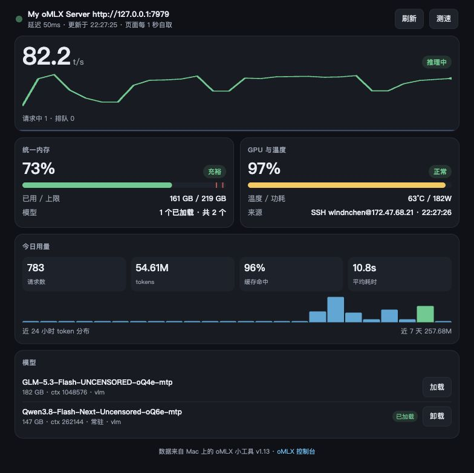

## oMLX 小工具 v1.13

**手机也能盯那台跑推理的 Mac 了。** 小工具自带一个极简 HTTP 服务，同一局域网里的手机、平板、
另一台电脑用浏览器打开 `http://<本机 IP>:7999`，看到的就是同一块仪表盘——不装 App，不再开第二条隧道。

<p align="center">
  
</p>

---

### 为什么发这一版

以前只有「小工具 → oMLX」这一路：小工具跑在手边那台 Mac 上，看的是它自己那块屏幕。
想在沙发上、在另一台机器上瞄一眼「刚才那批跑完没、内存还够不够、机器烫不烫」，
要么切回电脑，要么给 oMLX 那台再补一条隧道。这一版把小工具自己也变成一个网页：

- **依旧零第三方依赖**：`Network.framework` 上手写几十行 HTTP/1.1，不引 Vapor、不内嵌 Web 服务器。
  页面是内置的一段自包含 HTML + CSS + JS，**不联网取任何资源**，纯内网、断外网的环境照样开
- **不给 oMLX 添负担**：网页只读小工具内存里已经采好的那一帧，**一次 `/api/status` 都不会多问**，
  刷新节奏完全跟着 App 里设的「刷新间隔」走
- **手机优先**：窄屏布局，宽度不够时两张卡片自动上下叠；深色 / 浅色跟着手机系统翻；
  页面切到不活跃标签页自动停轮询，回到前台立刻续上

### 装上之后会看到什么

- 设置里多一个 **「局域网访问」** 区块：开关（默认开）、端口（默认 7999）、可选访问口令、
  当前状态与**被访问次数**、本机各网卡地址（私网段在前，逐条可拷贝）与**二维码**
- 右键菜单栏图标 → **局域网页面**：看状态与地址、拷贝地址、在浏览器打开、一键开关；
  菜单栏 tooltip 末尾也多出局域网地址，不进设置就能拿到那串 IP
- 页面能做的事与面板一致：逐任务彩色速度曲线、预填充整卡涨水、内存充裕 / 正常 / 偏高 / 吃紧四档、
  GPU 负荷色带与温度功耗、今日用量与 24 小时柱状图、模型 `加载` / `卸载`、`刷新` / `测速`
  （测速结果和加载结果直接回在页面顶部的提示条上）
- 访问口令留空 = 同网段谁都能看；填了则每个请求都要带 `?key=`，设置页与菜单拷出来的链接自动带上
- 覆盖安装即可，服务器地址、API Key、浮窗样式等偏好一律不动

### 三件容易撞上的事

1. **第一次开启时 macOS 会问一次**「是否允许 oMLX 小工具接收传入网络连接」，点允许；
   误点了拒绝就去 系统设置 → 网络 → 防火墙 里放行。判断依据：设置页那行「被访问 N 次」一直是 0，
   说明请求根本没到这台 Mac，不是页面的问题
2. **端口被占**：7999 被别的服务占了会自己往上找（最多试 8 个），实际端口写在设置页状态行，
   地址和二维码跟着一起换，不用手动改
3. **AP 隔离 / 访客网络**：路由器开了客户端隔离时手机和 Mac 互相不通，访客网络通常也进不了内网。
   这种网络环境还是回到 SSH 隧道那一路

### 谁需要升

只有**打算在电脑以外的设备上看**，这一版才有实际意义。不用的话把开关关掉，
它一个端口都不占、一条请求都不接，其余行为与 v1.12 完全一致。
另外 `GET /api/snapshot` 返回的就是这一帧 JSON，想接自己的仪表盘或 Home Assistant 也够用。

---

### 安装

下载 `oMLX.1.13.dmg`，打开后把 App 拖进 Applications。首次启动若提示「无法验证开发者」，
右键 App → 打开，确认一次即可（ad-hoc 签名，未做公证）。

**要求**：macOS 14.0+，Apple Silicon。

### 校验和

标准值见 Release 附件里的 **`SHA256.txt`** —— 由 CI 在构建 dmg 的同一步生成，永远对得上发布出去的那个文件。
本机自行构建的 dmg 与 CI 产物字节不同（打包时间戳等元数据），所以这里不写死哈希。

### 从源码构建

```bash
git clone https://github.com/windinchen/omlx-widget.git
cd omlx-widget
./build.sh --dmg      # 打包到桌面
```

零第三方依赖，只需要 Xcode Command Line Tools。
