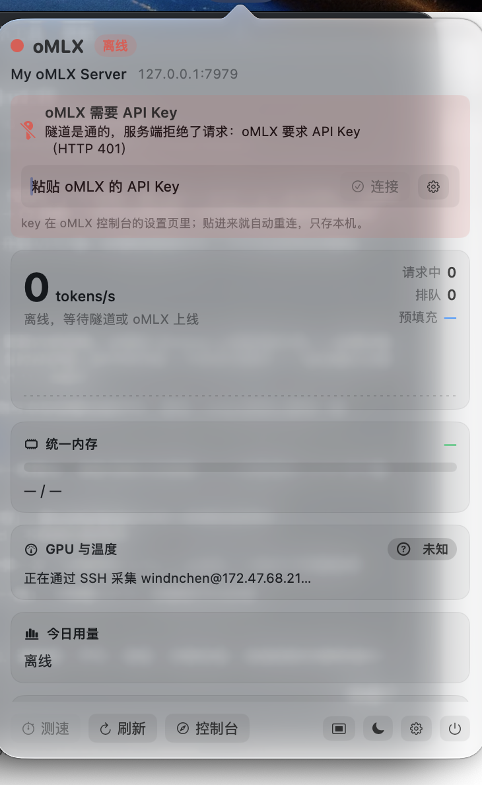

## oMLX 小工具 v1.12

**oMLX 一开鉴权，小工具不再一脸茫然地显示「离线」。** 现在它分得清「隧道没起」和「缺 API Key」，
并且能直接在面板里把 key 贴上就连上，不用再去设置页翻。

<p align="center">
  
</p>

---

### 为什么发这一版

oMLX 开启鉴权后，`/api/status` 会返回 `401 {"detail":"API key required"}`。v1.11 把它和
「隧道没起」混成同一条离线提示，而 `/v1/models` 不鉴权仍然返回 200，于是看起来像网络半通，
很难一眼想到是缺密钥：

```bash
curl http://127.0.0.1:7979/api/status
# {"detail":"API key required"}      ← 服务与隧道都是好的，只是没带 key
```

- 客户端把 401 / 403 单独识别成鉴权错误，与连接类错误分开上报
- 面板据此换一条专门的横幅，横幅里就是输入框，贴进 key 下一轮轮询即连上
- key 填过却仍被拒（oMLX 那边轮换过）时，横幅改口让你去核对 key

### 装上之后会看到什么

- 缺 key 时面板顶部：**「oMLX 需要 API Key」**，副标题写明「隧道是通的，服务端拒绝了请求」，
  右侧是输入框、`连接` 与 `打开设置`；填进去只存本机，不上传
- 平时不显示这条横幅：连得上就一切照旧
- 设置 → 服务器：`API Key` 从原先挤在「添加服务器」右边的一小格，提升为独立一行，
  旁边加了 `测试连接`，改完立刻重试并把结果显示在设置页底部，不用重启
- 覆盖安装即可，浮窗样式、透明度、字号、采集来源等偏好一律不动

### 谁需要升

只在**没开鉴权**的 oMLX 上用过的小工具，行为与 v1.11 完全一致：不填 key 就不带
`Authorization`，一条请求都不会多。只有在 oMLX 开了鉴权、或者准备开的时候，这一版才真正省事。

---

### 安装

下载 `oMLX.1.12.dmg`，打开后把 App 拖进 Applications。首次启动若提示「无法验证开发者」，
右键 App → 打开，确认一次即可（ad-hoc 签名，未做公证）。

**要求**：macOS 14.0+，Apple Silicon。

### 校验和

标准值见 Release 附件里的 **`SHA256.txt`** —— 由 CI 在构建 dmg 的同一步生成，永远对得上发布出去的那个文件。
本机自行构建的 dmg 与 CI 产物字节不同（打包时间戳等元数据），所以这里不写死哈希。

### 从源码构建

```bash
git clone https://github.com/windinchen/omlx-widget.git
cd omlx-widget
./build.sh --dmg      # 打包到桌面
```

零第三方依赖，只需要 Xcode Command Line Tools。
